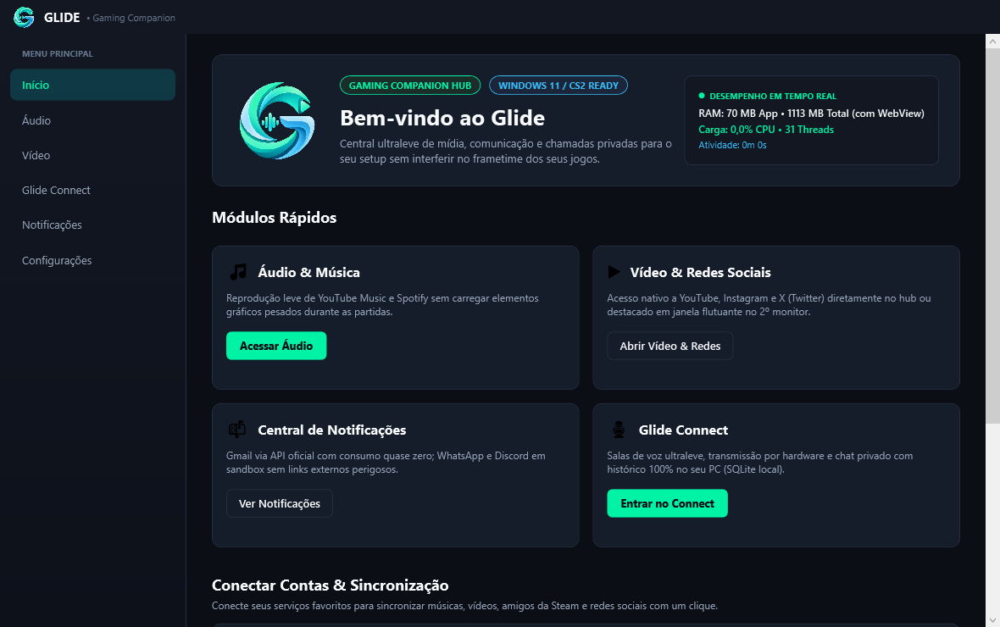
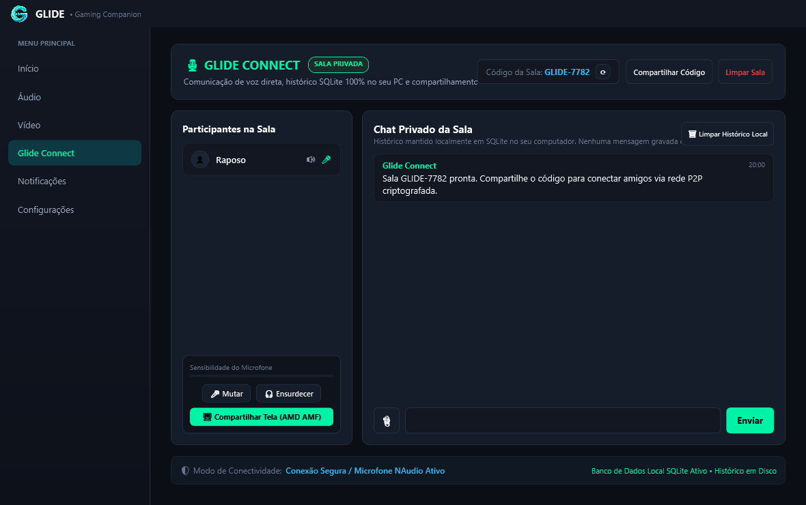
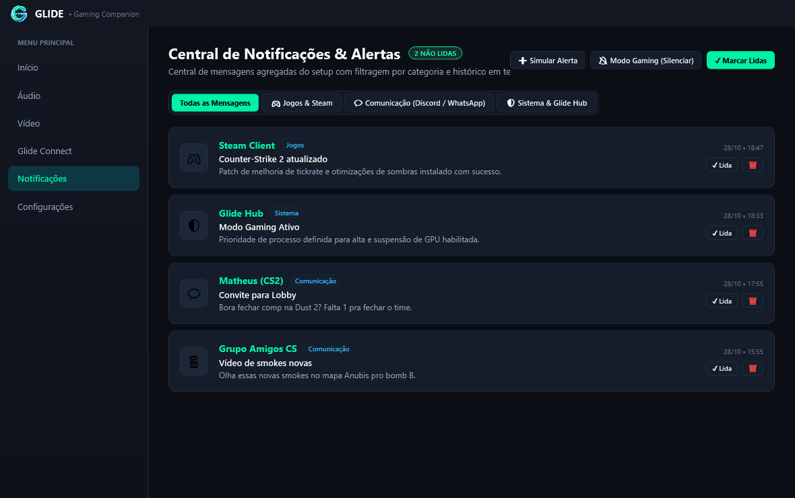
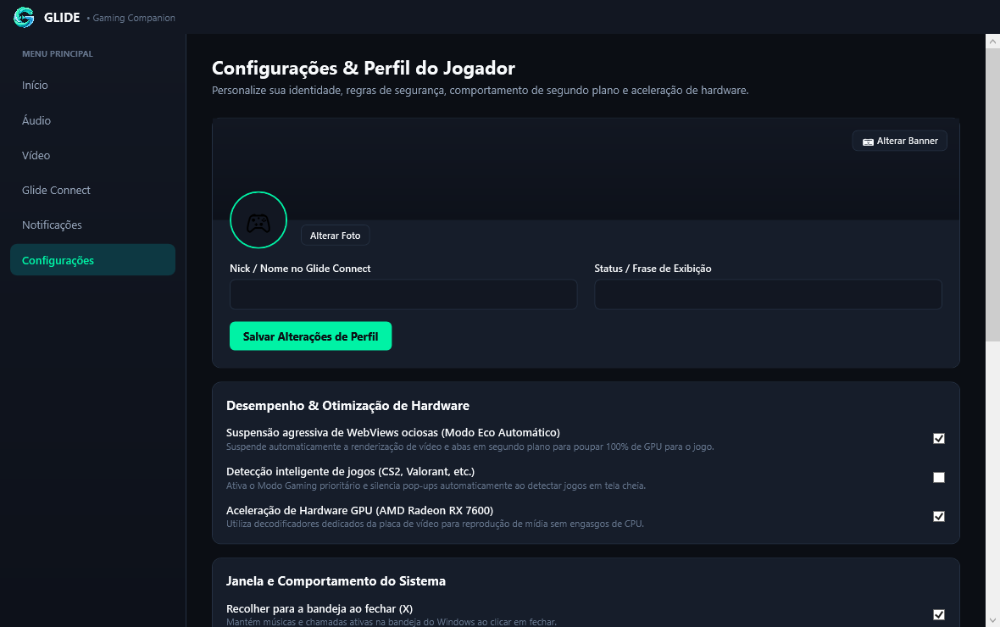

<div align="center">

  

  # GLIDE
  ### The Modern, Lightweight Gaming Companion Hub for Windows 11

  [](https://github.com/MiguelCruver/Glide)
  [](https://dotnet.microsoft.com/)
  [](https://github.com/MiguelCruver/Glide)
  [](https://github.com/MiguelCruver/Glide)
  [](LICENSE)
  [](#arquitetura)

  <p align="center">
    O <b>GLIDE</b> é um hub complementar de alto desempenho desenvolvido especificamente para gamers.<br />
    Gerencie músicas, assista a vídeos em janelas flutuantes sem perder FPS nos seus jogos, conecte-se com amigos via rede P2P criptografada e monitore a telemetria do seu sistema em tempo real — tudo com baixo consumo de memória e isolamento rigoroso de segurança.
  </p>

  <p align="center">
    <a href="https://github.com/MiguelCruver/Glide/releases/latest"><b>Baixar a Versão Mais Recente (v2.0) »</b></a>
    ·
    <a href="#demonstracao">Demonstração Visual</a>
    ·
    <a href="#funcionalidades">Funcionalidades</a>
    ·
    <a href="#como-compilar">Como Compilar</a>
    ·
    <a href="#arquitetura">Arquitetura</a>
  </p>

  <br />

  
</div>

---

<a name="demonstracao"></a>
## 📸 Demonstração Visual das Abas

| 🏠 Tela Inicial (Hero & Conexões) | 💬 Glide Connect (Rede P2P) |
| :---: | :---: |
|  |  |

| 🔔 Central de Notificações Unificada | ⚙️ Configurações & Isolamento de Segurança |
| :---: | :---: |
|  |  |

---

<a name="funcionalidades"></a>
## ⚡ Principais Funcionalidades

### 🌐 1. Glide Connect (Rede P2P em Tempo Real)
* **Salas Descentralizadas:** Crie ou entre em salas privadas (`GLIDE-XXXX`) compartilhando um código de 4 dígitos.
* **Detecção de Voz Real:** Captura de microfone de ultra-baixa latência com visualizador dinâmico de fala (anel neon ciano/verde).
* **Chat e Envio de Imagens:** Histórico salvo localmente em banco SQLite criptografado, com suporte a envio rápido de capturas de tela e imagens.
* **Zero Servidores Dedicados Pagos:** Sincronização pub/sub em tempo real com canais isolados.

### 🎵 2. Hub de Áudio com Seletor Ativo
* **Spotify & YouTube Music:** Alterne entre os dois maiores players do mundo sem sair do aplicativo.
* **MiniPlayer Flutuante:** Controle suas faixas (Play/Pause, Próxima, Anterior) e visualize capa e metadados enquanto joga.
* **Modo Eco de Áudio:** Suspende a renderização visual quando em segundo plano para economizar ciclos de GPU e CPU.

### 📺 3. Hub de Vídeo & Janela Flutuante (PIP)
* **Multi-Serviços:** Navegue diretamente pelo **YouTube**, **Instagram** ou **X (Twitter)**.
* **Janela Destacável (Always-on-Top):** Destaque o player de vídeo para uma janela compacta flutuante, ideal para segundo monitor ou canto da tela durante partidas.

### 📊 4. Telemetria de Desempenho em Tempo Real
* Medição contínua do uso real de **Memória RAM (MB)** do processo e WebView2.
* Monitoramento de **% de Uso de CPU**, **Contagem de Threads** ativas e **Tempo de Atividade (Uptime)**.

### 🔒 5. Segurança por Design e Isolamento Sandbox
* Perfis isolados de dados WebView2 em diretório restrito do usuário.
* Políticas estritas de navegação (*StrictNavigationPolicy*) com allowlist de domínios confiáveis para prevenir phishing e scripts maliciosos.
* Configurações de segurança críticas protegidas por diálogo de confirmação explícita.

---

## 🚀 Como Executar

### Opção 1: Instalador Oficial do Windows (Recomendado)
Você não precisa ter o .NET SDK ou qualquer ferramenta instalada:
1. Baixe o instalador oficial `Glide-Setup-v2.0.0.exe` na aba de [Releases](https://github.com/MiguelCruver/Glide/releases/latest).
2. Execute o instalador e siga o assistente passo a passo (**Avançar > Instalar**).
3. O instalador cria automaticamente os atalhos na Área de Trabalho e no Menu Iniciar e já abre o Glide pronto para uso.

### Opção 2: Executável Portátil (Portable Standalone)
* Caso prefira rodar sem instalar nada no Windows, baixe `Glide.App.exe` diretamente na aba de Releases.

### Opção 2: Compilar a partir do Código-Fonte
Para desenvolvedores e colaboradores que desejam compilar o projeto localmente:

**Pré-requisitos:**
* Windows 10 (Build 19041+) ou Windows 11 (x64)
* [.NET 8.0 SDK](https://dotnet.microsoft.com/download/dotnet/8.0)
* Visual Studio 2022 ou VS Code com extensão C# Dev Kit

**Passo a passo no terminal:**
```bash
# 1. Clone o repositório
git clone https://github.com/MiguelCruver/Glide.git
cd Glide

# 2. Restaure as dependências
dotnet restore Glide.sln

# 3. Execute a suíte de testes unitários
dotnet test Glide.sln

# 4. Inicie o aplicativo em modo Debug
dotnet run --project src/Glide.App/Glide.App.csproj
```

**Gerar executável único de produção (Standalone):**
```bash
dotnet publish src/Glide.App/Glide.App.csproj -c Release -r win-x64 --self-contained true -p:PublishSingleFile=true -p:IncludeNativeLibrariesForSelfExtract=true -o release_standalone
```

---

## 🏛️ Arquitetura do Projeto

O Glide é estruturado em arquitetura modular limpa:

```text
Glide/
├── assets/
│   └── branding/              # Logotipos oficiais 3D e assets gráficos
├── src/
│   ├── Glide.Core/            # Entidades de domínio, Enums, Contratos e Políticas de Segurança
│   │   ├── Enums/
│   │   ├── Models/
│   │   └── Security/
│   ├── Glide.Providers/       # Provedores de serviços e abstrações
│   └── Glide.App/             # Aplicação WPF (.NET 8)
│       ├── Assets/            # Ícones (.ico) e imagens do aplicativo
│       ├── Helpers/           # Helpers do Microsoft Edge WebView2
│       ├── Services/          # P2P Online, SQLite, Microfone (NAudio), Métricas e Notificações
│       ├── Themes/            # Design System (Cores neon, botões vetoriais, estilos)
│       ├── ViewModels/        # Padrão MVVM com comandos reativos e Data Binding
│       └── Views/             # Telas XAML (Home, Audio, Video, Connect, Settings, Notificações)
└── tests/
    └── Glide.UnitTests/       # Suíte com 38 testes automatizados (xUnit)
```

---

## 🛠️ Tecnologias Utilizadas

* **Linguagem & UI:** C# 12, .NET 8.0, WPF (Windows Presentation Foundation) com WindowChrome nativo.
* **Componente Web:** `Microsoft.Web.WebView2` (Chromium Engine com sandbox isolada).
* **Áudio:** `NAudio 2.2.1` para captura de dados PCM em buffer contínuo e cálculo de RMS em tempo real.
* **Banco Local:** `Microsoft.Data.Sqlite 10.0` para persistência offline de histórico e salas.
* **Rede P2P:** `MQTTnet 5.2` com arquitetura pub/sub de baixa latência e zero credenciais expostas.
* **Testes:** `xUnit 2.9`, testando serviços de criptografia, isolamento, catálogo de serviços e MVVM.

---

## 🤝 Como Contribuir

Contribuições são muito bem-vindas!
1. Faça um Fork do projeto (`git fork`).
2. Crie uma branch para sua funcionalidade (`git checkout -b feature/minha-feature`).
3. Faça o commit das suas alterações (`git commit -m 'feat: adiciona nova funcionalidade'`).
4. Envie para o seu fork (`git push origin feature/minha-feature`).
5. Abra um **Pull Request**.

---

## 📜 Licença

Distribuído sob a licença **MIT**. Consulte o arquivo [`LICENSE`](LICENSE) para mais detalhes.

---

<div align="center">
  Desenvolvido com foco em desempenho, privacidade e imersão para gamers.
</div>
